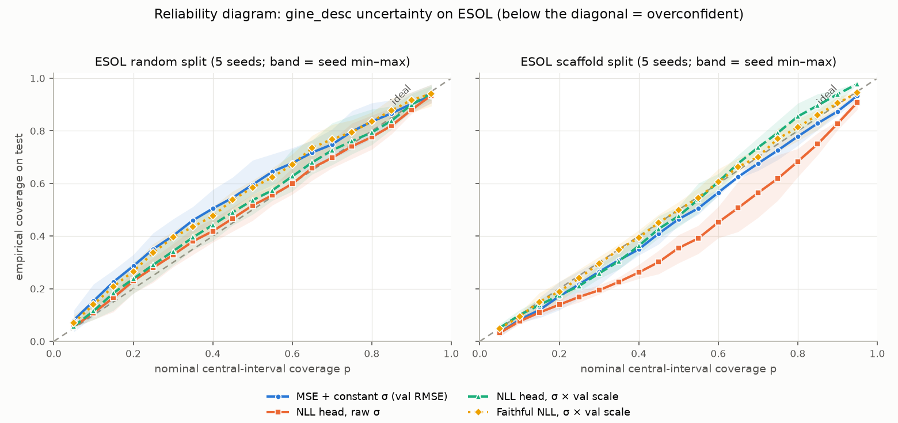
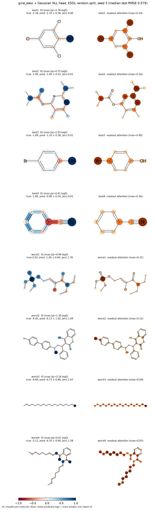

# molecular-solubility-gine

Interpretable molecular property prediction with a descriptor-fused graph network, plus calibrated uncertainty and integrated-gradient attributions.

Started as my final-year research project at the University of Leeds (Feb–May 2025, advisor Prof. Yongquan Jiang), rebuilt as the two packages here in 2026, and extended in October 2026 with the calibration, attribution and ensemble work described below.

| Path | What it is |
| --- | --- |
| `ChemPath-GINE/` | Main experiment package: GINE baselines, descriptor fusion, the ChemPath path-attention module with its negative controls, tabular baselines, and the uncertainty / attribution / ensemble code (`chempath_gine/uncertainty/`, `chempath_gine/extensions/`). |
| `MolFuse-GINE/` | Follow-up "system" track: a pool of graph, descriptor, fingerprint, fragment, 3D and pretrained-SMILES experts combined by out-of-fold stacking under a strict train-only protocol (`MolFuse-GINE/docs/EXPERIMENT_PROTOCOL.md`). |
| `reports/` | `calibration_interpretability_2026-10-17.md` — the calibration, interpretability and ensemble rounds with every number and disclosure (in Chinese) — and its figures. `ChemPath-GINE/reports/summary_findings.md` is the post-review summary of the main comparison. |

Run directories, checkpoints and logs are not versioned; every table below can be regenerated with the commands in [Reproduce](#reproduce).

## Task and data

Three MoleculeNet / DeepChem regression benchmarks. Input is a SMILES string, output is one real value, the metric is RMSE.

| Dataset | Target | Molecules |
| --- | --- | ---: |
| ESOL | aqueous solubility, log mol/L | 1,128 |
| Lipophilicity | octanol/water distribution coefficient (logD) | 4,200 |
| FreeSolv | hydration free energy, kcal/mol | 642 |

The processed CSVs are included under `*/data/processed/` (public data; sources in `ChemPath-GINE/data/README.md`).

Protocol: random and scaffold splits (70 / 15 / 15), five seeds per setting, checkpoints chosen on validation loss only, the test set scored once from the chosen checkpoint, descriptor and target scalers fitted on the training split only. The scaffold partition is deterministic, so its five seeds vary training randomness rather than scaffold membership.

## Models

- **Tabular baselines** — RDKit physicochemical descriptors and Morgan / MACCS fingerprints fed to Ridge, ElasticNet, SVR, random forest and XGBoost (`chempath_gine/baselines/tabular.py`).
- **GINE** — edge-aware graph isomorphism network over atom and bond features: three layers, hidden size 128, attention + mean + max readout (`chempath_gine/models/gine_encoder.py`).
- **Descriptor fusion, `gine_desc`** — the graph embedding is fused with six Delaney-style descriptors (minimum degree, molecular weight, H-bond donors, ring count, rotatable bonds, polar surface area) through a gated addition; concat, FiLM, low-rank bilinear and residual-add variants are ablated (`chempath_gine/models/descriptor_fusion.py`).
- **ChemPath path attention** — a dense attention layer whose logits carry a structured bias built from all-shortest-path features: distance embedding, shortest-path count, bond and path counts, and relation type (donor/acceptor, same ring, motif touch, disconnected), multiplied by a learnable scale initialised near zero (`chempath_gine/features/chem_path.py`, `chempath_gine/models/chem_path_attention.py`).
- **Negative controls for ChemPath** — `zero attr, same params` (path features zeroed, parameter count unchanged) and `bucket shuffle` (path features permuted). If the real path features do not beat both controls, the bias is not doing causal work.

## Results

ESOL test RMSE, mean over five seeds (standard deviations and the Lipophilicity / FreeSolv rows: `ChemPath-GINE/reports/summary_findings.md`; ensemble rounds: `reports/calibration_interpretability_2026-10-17.md`).

| Model | random | scaffold |
| --- | ---: | ---: |
| Best tabular baseline (XGBoost on descriptors + fingerprints) | 0.80 | 1.21 |
| GINE, graph only | 0.67 | 1.16 |
| **`gine_desc`, GINE + descriptor fusion, single model** | **0.56** | **0.93** |
| Ensemble system (see note) | 0.53 | 0.81 |

**Note on the ensemble row.** This is a ten-model system — five GINE and five D-MPNN members — with Crippen logP added as a seventh descriptor, each member refit on train + validation after its epoch count was chosen on the validation set. Selection used validation data and a set of fresh confirmation splits, but the original ESOL test set was scored twice during this work (after round 2 and again after round 3), and the confirmation splits partly overlap the original test molecules. The single-model `gine_desc` row is therefore the headline result; the ensemble row is reported with that caveat. Against the paired baseline the ensemble's improvement is −0.025 [−0.050, −0.001] (random) and −0.106 [−0.178, −0.033] (scaffold), 95% bootstrap intervals over molecules.

The same single-model comparison on the other two datasets:

| Dataset | Split | Best tabular | GINE | `gine_desc` |
| --- | --- | ---: | ---: | ---: |
| Lipophilicity | random | RF 0.94 | 0.61 | 0.60 |
| Lipophilicity | scaffold | RF 1.02 | 0.73 | 0.69 |
| FreeSolv | random | XGBoost 1.61 | 1.36 | 1.26 |
| FreeSolv | scaffold | RF 2.68 | 2.67 | 2.32 |

**ChemPath path attention.** Under the strict controls the full model does not beat the zero-attribute and shuffled controls on ESOL random (0.587 vs 0.579 / 0.573) or Lipophilicity scaffold, and shows only a small positive signal on ESOL scaffold and Lipophilicity random. It is kept as an implemented and tested exploratory module, not claimed as a contribution.

## Calibration

The regression head of `gine_desc` is replaced by a Gaussian negative-log-likelihood head that predicts μ and log σ². ESOL, five seeds, test set:

| Split | Method | RMSE | ECE | 90% coverage | 90% width (logS) |
| --- | --- | ---: | ---: | ---: | ---: |
| random | MSE baseline, constant σ = validation RMSE | 0.556 | 0.070 | 0.902 | 1.86 |
| random | NLL head, raw σ | 0.558 | **0.033** | 0.880 | 1.64 |
| random | NLL head, σ scaled on the validation set | 0.558 | 0.037 | **0.900** | 1.73 |
| scaffold | NLL head, raw σ, single model | 0.968 | 0.102 | 0.827 | 2.60 |
| scaffold | NLL head, 5-member deep ensemble, no rescaling | 0.956 | 0.056 | **0.899** | 2.95 |

ECE is the regression form: the mean absolute gap between nominal and empirical interval coverage over 19 nominal levels. On the random split the NLL head leaves RMSE unchanged, lowers ECE on 5/5 seeds, and makes σ informative: the half of the test set with the smallest σ has RMSE 0.41, the other half 0.67. On the scaffold split a single NLL model is over-confident; a five-member deep ensemble restores 90% coverage without any rescaling, although its ECE stays above the constant-σ baseline. Split-conformal intervals and a β-NLL / "faithful" (decoupled variance head) sensitivity check are in the report.



## Interpretability

Integrated gradients are computed jointly over the atom embeddings, bond embeddings and standardised descriptors (zero baseline, 128-step Riemann sum, completeness error median 0.009 logS), averaged within RDKit symmetry classes so that equivalent atoms share credit, and drawn with RDKit `MolDraw2D`. The readout attention-pooling weights are drawn alongside for comparison.

- Polar groups raise predicted solubility in 5/5 seeds on both splits: hydroxyl O +1.26 logS per atom, carbonyl O +0.69, aromatic N +0.38; aromatic and aliphatic carbons lower it on average.
- Occlusion check: removing the top-1 atom chosen by IG moves the prediction 2.2–2.7× as much as removing a random atom; the atom chosen by attention 1.9–2.1×. Per-atom |IG| correlates with the occlusion effect at 0.47–0.50, attention at 0.24–0.30, so explanations use IG.
- Agreement with Crippen atomic logP contributions is weak (atom-level Spearman about 0.2), and halogen effects seem partly absorbed by the molecular-weight descriptor, so atom colours are not read literally.



## Reproduce

Everything runs inside `ChemPath-GINE/` with Python ≥ 3.10, PyTorch, PyTorch Geometric, RDKit, pandas, scikit-learn, XGBoost and PyYAML (`requirements.txt`). A GPU is optional: all calibration, attribution and ensemble numbers above were produced on CPU, about 20 s per training run.

```bash
cd ChemPath-GINE
pip install -r requirements.txt && pip install -e .
python -m pytest -q        # unit tests, including a 2-epoch training smoke test

# 1. Main comparison: GINE vs descriptor fusion, ESOL, 5 seeds (repeat with esol_fusion_ablation_scaffold.yaml)
python scripts/run_ablation.py --config configs/esol_fusion_ablation_random.yaml \
  --variants gine,gine_desc,gine_desc_concat,gine_desc_residual_add,gine_desc_film_graph,gine_desc_lowrank_bilinear \
  --seeds 1,2,3,4,5 --out ablation_runs/esol_fusion_random_5seed

# 2. Tabular baselines under the same split protocol
python scripts/run_tabular_baselines.py --config configs/esol_gine_desc16.yaml \
  --feature-sets desc16,morgan2,desc16_morgan2,desc16_morgan2_maccs \
  --models ridge,elasticnet,svr,rf,xgb --seeds 1,2,3,4,5 --out tabular_runs/esol_random

# 3. ChemPath path attention against its negative controls
python scripts/run_ablation.py --config configs/esol_chempath_diagnostic_random.yaml \
  --variants chempath_desc_full,chempath_desc_zero_attr_same_params,chempath_desc_shuffle_bucket \
  --seeds 1,2,3,4,5 --out ablation_runs/esol_chempath_diag_random

# 4. Calibration: MSE baseline, Gaussian-NLL head and the decoupled "faithful" head, both splits
for split in random scaffold; do
  for mode in mse nll faithful; do
    python scripts/run_calibration.py --config configs/esol_fusion_ablation_${split}.yaml \
      --mode ${mode} --seeds 1,2,3,4,5 --out calibration_runs/esol_${split} --threads 2
  done
done
python scripts/summarize_calibration.py --roots calibration_runs/esol_random,calibration_runs/esol_scaffold \
  --out calibration_runs/summary --fig-dir ../reports/figures/new

# 5. Integrated gradients, attention weights and RDKit highlights
python scripts/run_interpretability.py --runs-root calibration_runs/esol_random --mode nll \
  --fig-dir ../reports/figures/new/esol_random_interpretability --out calibration_runs/interpretability/esol_random

# 6. Deep ensembles: four extra members per seed, then ensemble metrics and conformal intervals
for split in random scaffold; do
  for mode in nll faithful; do
    python scripts/run_calibration.py --config configs/esol_fusion_ablation_${split}.yaml \
      --mode ${mode} --seeds 1,2,3,4,5 --members 1,2,3,4 --out calibration_runs/esol_${split} --threads 2
  done
done
python scripts/build_ensembles.py --roots calibration_runs/esol_random,calibration_runs/esol_scaffold \
  --out calibration_runs/ensembles --fig-dir ../reports/figures/new
```

The cross-architecture ensemble, the confirmation splits, the refit and the bootstrap comparison (`build_mixed_ensembles.py`, `make_confirmation_splits.py`, `final_system_eval.py`, `bootstrap_compare.py`) are documented in section 12 of the report. `MolFuse-GINE/README.md` and its `Makefile` cover the stacking track.

## Limitations

- Calibration, interpretability and the ensemble were done on ESOL only; Lipophilicity and FreeSolv have the single-model comparison only.
- The validation set is reused for early stopping, checkpoint and configuration selection, the variance head and calibration, so validation numbers are optimistic and the conformal guarantee is approximate.
- The original ESOL test set was scored twice for the ensemble rounds, and the confirmation splits share molecules with it; see section 10 of the report for the full disclosure.
- On CPU, GINE runs are bit-reproducible at a fixed thread count; D-MPNN members reproduce only statistically. The archived single-model numbers (0.559 / 0.929) were likely produced on CUDA; the CPU rerun gives 0.556 / 0.919, within the seed spread.

## Acknowledgements

Advisor: Prof. Yongquan Jiang. Datasets: MoleculeNet / DeepChem (ESOL from Delaney 2004, Lipophilicity from ChEMBL / AstraZeneca, FreeSolv from Mobley and Guthrie). Built on PyTorch Geometric and RDKit.

## License

MIT, © 2025–2026 Kairan Shen.
